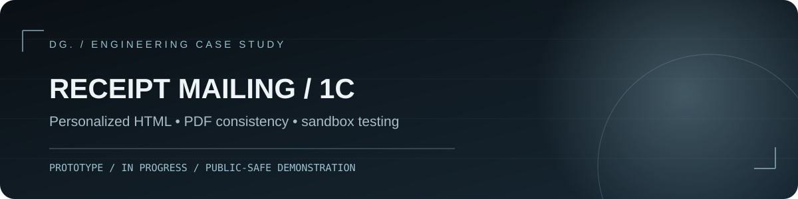

# Персонализированная HTML-рассылка квитанций из 1С

Прорабатывал HTML-письмо для штатной рассылки квитанций из 1С: подстановку реквизитов и точной суммы, сохранение PDF-вложения и проверку в изолированной тестовой среде.

**Что можно посмотреть:** В репозитории можно сформировать учебное письмо и проверить экранирование полей. Демонстрация не подключается к 1С, не отправляет почту и не содержит реальных квитанций.

**Тип:** профессиональный кейс · **Статус:** прототип и тестирование в отдельной копии базы; промышленное внедрение **не подтверждено**.

> Производственный `.cfe`, код типовой рассылки, адреса клиентов, SMTP-учётные данные и реальные PDF здесь отсутствуют. `demo/` — **независимый безопасный макет**, который не отправляет письма.

## Задача

Дополнить штатную рассылку квитанций визуально оформленным HTML-письмом, сохранив вложенный PDF и персональные реквизиты: ЛС, адрес, период, итоговую сумму именно из квитанции, срок оплаты и контакты организации. Для отдельного клиента предпочтительна локальная доработка через расширение, если проверка совместимости это допускает.

## Инженерные особенности

- Исследование штатного механизма формирования PDF и массовой рассылки; поиск источника **точной итоговой суммы**.
- Отдельный HTML-шаблон и подстановки; не смешивать содержание письма с логикой транспорта.
- Тестовая копия базы, отключённые регламентные задания, защита от рассылки настоящим получателям.
- Перенаправление SMTP на локальный Mailpit в тестовом окружении и ограничение тестового отбора.
- Проверка письма, вложения и равенства суммы письма и PDF до реальной отправки.

## Публичный макет без отправки писем

```bash
python -m demo.render_preview
python -m unittest discover -s tests -v
```

Команда записывает `demo/preview.html` **исключительно с фиктивными реквизитами**. Открой файл браузером. Отправки SMTP, чтения PDF и подключения к 1С в этой демонстрации нет.

| Риск | Мера |
|---|---|
| Случайная массовая отправка | тестовая база + ограничение получателей + локальный перехват SMTP |
| Расхождение письма и квитанции | сумма из того же расчётного источника, сверка перед отправкой |
| Доработка затрагивает все клиентские базы | проверка применимости отдельного расширения |
| Подстановка HTML-инъекций | экранирование отображаемых полей |

Подробности: [контрольные тесты](docs/test-plan.md), [архитектура](docs/architecture.md) и [условия публикации](PUBLICATION_CHECKLIST.md).

## Требования и структура

Нужен Python 3.10 или новее. Внешние пакеты не требуются: используется только стандартная библиотека. Команды запускайте из корня репозитория. Автопроверки GitHub Actions настроены на Python 3.12.

```text
README.md       — задача, вклад, статус и запуск
demo/           — независимая демонстрация
docs/           — архитектура и ограничения
assets/         — обложка кейса
tests/          — модульные тесты демо
.github/        — автоматические проверки
```

## Права на материалы

Лицензия на свободное использование не предоставлена. Условия повторного использования кода и материалов необходимо согласовать с правообладателем. Публикация кейса не предоставляет прав на продукты 1С, 1С-Битрикс или материалы третьих лиц.
