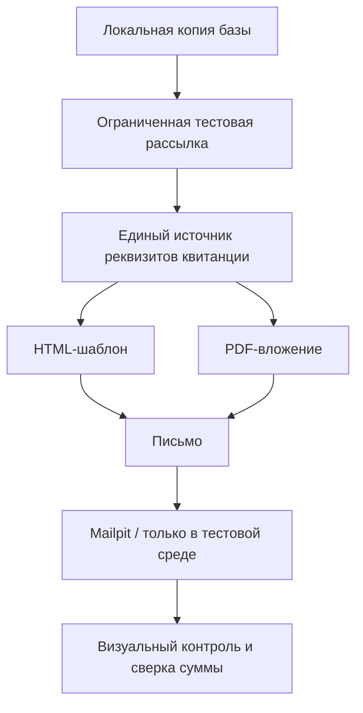

# Архитектура тестового сценария

## Границы

- Рабочая рассылка остаётся нетронутой до проверки совместимости и сценария внедрения.
- Реальные адреса получателей и SMTP-пароли не должны попадать в тестовые примеры, конфигурацию системы контроля версий и скриншоты.
- Публичный рендерер ниже только демонстрирует шаблонизацию; реальный 1С-код выполняет иные задачи и не публикуется.
